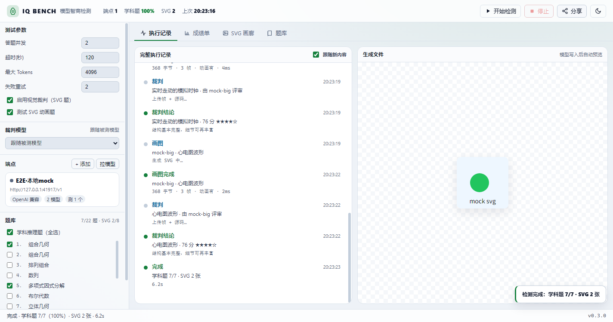
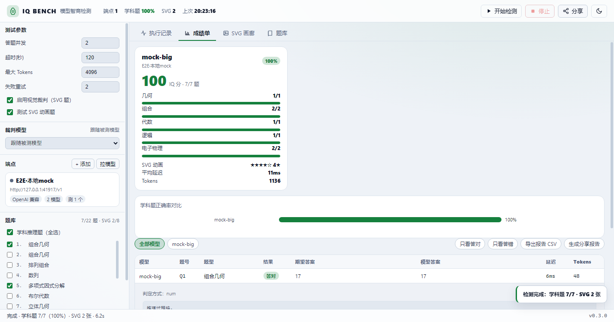
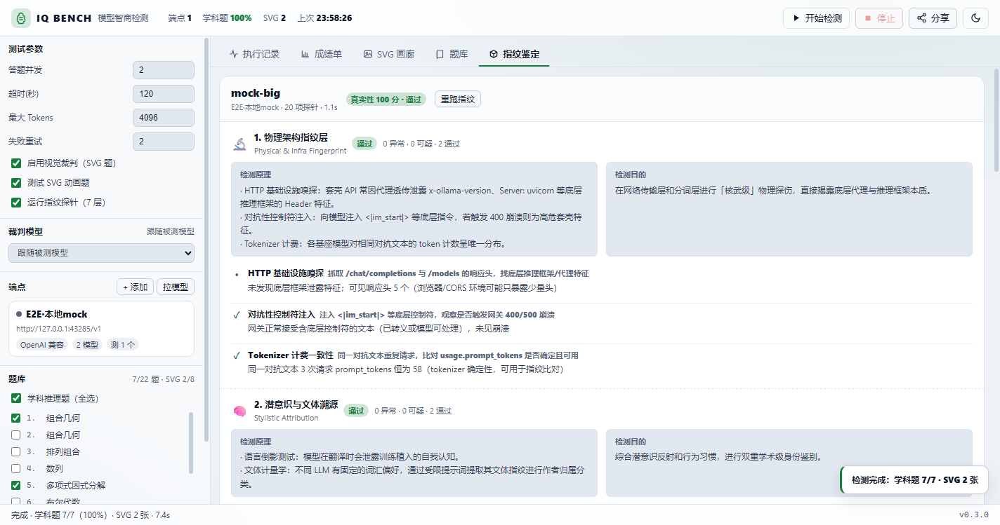
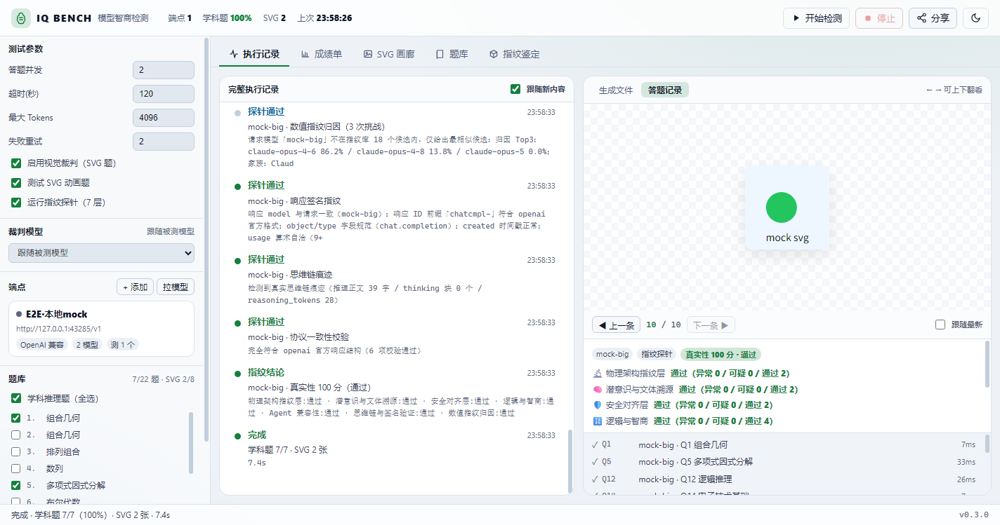
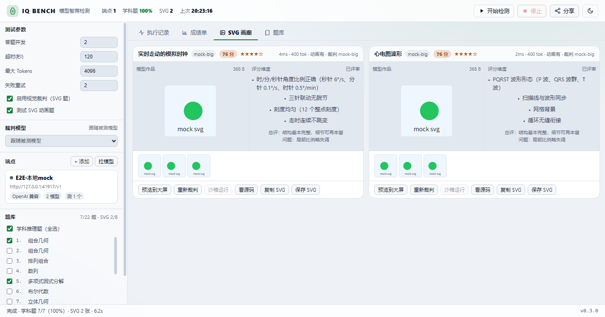
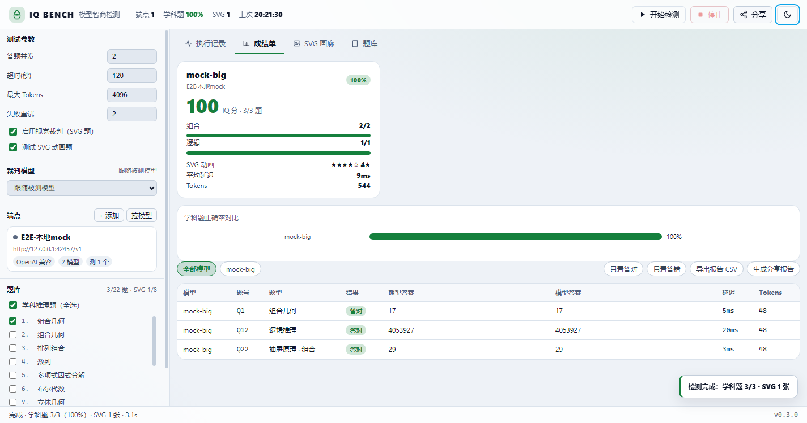

# 模型智商检测 · IQ Bench

[](https://github.com/salem-2007/api-vitals)
[](https://github.com/salem-2007/api-vitals)
[](https://github.com/salem-2007/api-vitals)

> 项目仓库：[github.com/salem-2007/api-vitals](https://github.com/salem-2007/api-vitals) · 喜欢的话点颗星 ⭐

面向 **OpenAI 兼容 / Anthropic / Gemini** 接口的模型能力测评桌面工具。
两类测试并行覆盖「会算」与「会画」：

| 测试 | 数量 | 判定方式 |
|---|---|---|
| **学科推理题** | 22 道（组合 / 几何 / 代数 / 数列 / 逻辑 / 电子物理） | 本地自动判分：数值严格比对、关键词、与或组、等价式变形；歧义题可 **AI 复核** 或 **人工改判** |
| **SVG 动画生成题** | 8 道（含「精细复合场景」大题） | 模型输出 SVG → 渲染成多帧截图 → **AI 视觉裁判**按评分维度逐项评审打分（0-100 / ★0-5） |
| **指纹鉴定（7 层 20 项探针）** | 20 项 | 网络层 / 分词层 / 文体 / 安全对齐 / 逻辑 / 协议签名 / **数值指纹归因**，判定 API 背后是否真是指称的那个模型 |

动画题不需要参考作品：裁判拿到的是 **动画帧 + 源码 + 评分维度清单**，直接评「结构是否完整、动画是否正确、细节是否到位」。

## 界面

### 执行记录 · 生成文件预览



左侧是完整执行记录时间轴（每条请求、每次重试、每次裁判都留痕），右侧自动预览模型生成的 SVG（动画实时播放）。

### 成绩单



每个模型一张卡：IQ 分（学科题正确率）、分类得分条、SVG 平均星级、平均延迟、Token 消耗；下面是逐题明细表，行内可展开看原始回答。

### 指纹鉴定



7 层探针逐项给证据：HTTP 基础设施嗅探（`x-ollama-version` / `Server: uvicorn` 等底层框架泄露）、
对抗性控制符注入、Tokenizer 计费一致性、语言倒影与身份自述、拒绝风格、浮点陷阱与幻觉、
Agent JSON/工具调用兼容性、思维链痕迹与协议签名校验，以及
**数值指纹归因**（ModelTrace 算法：让模型生成 [1,355] 长整数序列，与 18 个候选模型的统一指纹库比对，
输出家族/版本概率）。

### 答题记录（运行中可上下翻看）



检测进行时，右侧面板切到「答题记录」即可用 `←` `→` 或按钮逐条翻看已完成的题、SVG 与指纹结果，
含期望答案、模型答案、判定方式、原始输出；默认「跟随最新」，手动翻页后自动暂停跟随。

### SVG 画廊



每个作品：模型输出（左）与评分维度逐项判定（右）、动画帧条、总评与问题清单，可重新裁判 / 沙箱运行 / 复制保存 SVG。

### 明亮主题



## 功能

- **题库本地内置**：不联网、不依赖外部数据集；题型 / 参考难度 / 分组可筛选，逐题可勾选
- **判分可解释**：每题记录「判定方式」（num / any / all / digits / alts），原始输出与补答过程全保留
- **稳定性设计**：
  - HTTP 429 → 指数退避持续重试（读 `Retry-After`）
  - `finish_reason=length` → 自动抬高 `max_tokens`（上限可配）重答
  - 有推理但没给出最终答案 → 追加一次短请求只让它补「答案：X」
- **并发**：同一模型内多题并发（1-16 可调），模型之间串行，日志实时滚动
- **视觉裁判**：
  - 帧捕获：把模型 SVG 以 `` 无脚本方式渲染，按时间轴抓 3 帧并做帧间差异检测（判断动画是否真的在动）
  - 裁判模型可指定（默认跟随被测模型），支持 OpenAI 视觉 / Anthropic / Gemini 三种协议的图像载荷
  - 输出严格 JSON：分数 / 星级 / 每维度是否达标 + 理由 / 问题 / 建议
- **报告**：一键生成分享用 Markdown（复制 / 存 .md）+ 完整 CSV（模型成绩 / 逐题明细 / SVG 结果）
- **安全**：报告与导出**不含 API Key**；SVG 预览走 ``（脚本不执行），需要跑脚本时走 `sandbox="allow-scripts"` 的隔离 iframe
- **桌面壳**：WinForms + WebView2，单文件 exe，前端资源内嵌，无外部依赖

## 快速开始

### 桌面版

需要 .NET 10 桌面运行时（框架依赖发布）。

```bash
cd winapp
bash build.sh          # 产物：winapp/dist/IQBench.exe
```

或直接从 Releases 下载 `IQBench.exe` 双击运行。

首次使用：

1. 左侧「+ 添加端点」，填 Name / BaseURL / API Key（BaseURL 只写域名会自动补 `/v1`）
2. 点「拉取模型」，在端点编辑器里勾选要测的模型（不勾 = 自动取前 2 个）
3. 侧栏确认测试项：学科题逐个勾选、`测试 SVG 动画题` 开关、`启用视觉裁判` 开关
4. 点右上角 **开始检测**；跑完看「成绩单」和「SVG 画廊」
5. 「分享」生成报告

### MiniApp 版

由 AppUI 运行时加载，入口 `main.py`，3 个 Tab：检测 / 成绩 / 配置。

- 学科题判分、重试策略、报告生成与桌面版同语义（共用同一份题库）
- SVG 题可生成并保存源码；评审走**源码评审**（MiniApp 无浏览器渲染，无法截帧做视觉评审，界面里已标注）
- 报告不含 API Key

## Token 消耗提示

一轮完整测试 = 每模型 22 道题 + 8 张 SVG + 8 次裁判请求。
按单题 1-4k、单张 SVG 4-12k、裁判 1-3k 估算，**单模型约 8 万 - 20 万 Token**（长推理模型更高）。
建议先只勾 3-5 道题 + 1 张 SVG 试水，确认链路与费用后再全量。

## 项目结构

```
.
├── winapp/                      # Windows 桌面版
│   ├── Program.cs               # 原生壳：开窗、嵌 WebView2、数据读写桥、剪贴板、日志
│   ├── IQBench.csproj           # 内嵌 wwwroot 资源，单文件发布
│   ├── build.sh                 # WSL 交叉构建脚本
│   ├── wwwroot/
│   │   ├── index.html
│   │   ├── questions.js         # 题库（唯一数据源）：22 道学科题 + 8 道 SVG 题
│   │   ├── engine.js            # 引擎层：协议适配 / 答题 / 画图 / 视觉裁判 / 判分 / 统计 / 报告（零 DOM）
│   │   ├── app.js               # UI 层：状态、渲染、检测编排、帧捕获、报告
│   │   └── app.css              # 双主题设计令牌（OLED 暗色 + 临床亮色）
│   └── test/                    # 桌面版测试（见 winapp/test/README.md）
│
├── main.py                      # MiniApp 版（AppUI 运行时，3 Tab）
├── services.py                  # MiniApp 版引擎：与 engine.js 同语义（判分/重试/补答/评审/报告）
├── bank_data.py                 # 题库（由 questions.js 生成，两端逐字一致）
├── miniapp.json                 # MiniApp 元数据
├── widgets/home/                # MiniApp 桌面小组件
├── tools/                       # 题库生成器 + MiniApp 测试
│   ├── gen_py_bank.mjs          # questions.js → bank_data.py
│   ├── test_miniapp.py          # services.py 单测（自带 Python mock）
│   └── test_miniapp_ui.py       # 用 stub appui 真实构建三个页面，抓 API 误用
└── docs/screenshots/
```

题库只有一份真源：`winapp/wwwroot/questions.js`。改了题跑 `node tools/gen_py_bank.mjs` 重新生成 `bank_data.py`，两端自动同步。

分层原则：`engine.js` 纯逻辑不碰 DOM，因此能在 Node 里直接跑单测；`app.js` 只管渲染与编排。

## 测试

```bash
# 桌面版（Node）
cd winapp
node test/test-engine.mjs   # 引擎单测：判分 / SVG 抽取 / 裁判解析 / 统计 / 报告 / HTTP 全链路（自带 mock）
node test/e2e-ui.mjs        # 端到端：真实浏览器 + CDP 跑完整检测并断言 DOM（自带静态服务与 mock）
node test/audit.mjs         # UI 审计：对比度 / 焦点 / 减弱动效 / 横向滚动 / 触达尺寸 / 图表可访问性

# MiniApp（Python，零依赖）
python3 tools/test_miniapp.py      # services.py 单测：判分 / 重试 / 补答 / 评审 / 统计 / 报告
python3 tools/test_miniapp_ui.py   # stub appui 真实构建三个页面，抓 AppUI API 误用
```

浏览器自动探测（WSL 找 Windows 侧 Chrome/Edge，Linux 找 chrome/chromium），也可用 `BROWSER_PATH` 指定。
CI（`.github/workflows/test.yml`）每次推送跑：引擎单测 + 端到端 + UI 审计 + MiniApp 单测/页面构建，以及 Windows runner 上的客户端构建校验。

## 结果解读说明

测评结果只代表 **特定题库、提示词、采样参数、接口路由与测试时间** 下的表现：

- 「IQ 分」= 学科题正确率，不代表模型真实智力或综合能力
- SVG 评分由 AI 裁判给出，存在主观性；建议同题多跑几次看稳定性
- 中转站可能改写模型名、路由或限流；同一模型名在不同站点成绩可能差异很大

## 第三方与致谢

- **数值指纹归因** 的算法与指纹库来自 [ModelTrace](https://github.com/xqy2006/ModelTrace)（MIT License, Copyright (c) 2026 xqy2006）：
  `winapp/wwwroot/mtfp.js` 为该仓库 `fingerprint-core.mjs` 的原样 vendor（未改算法逻辑），
  `winapp/wwwroot/mtfp-bank.js` 为裁剪后的 `unified_bank.json`（仅保留打分所需向量）。
- 题库中的「精细 SVG · 复合场景」与「糖果题」由使用者提供。

## 许可

MIT
